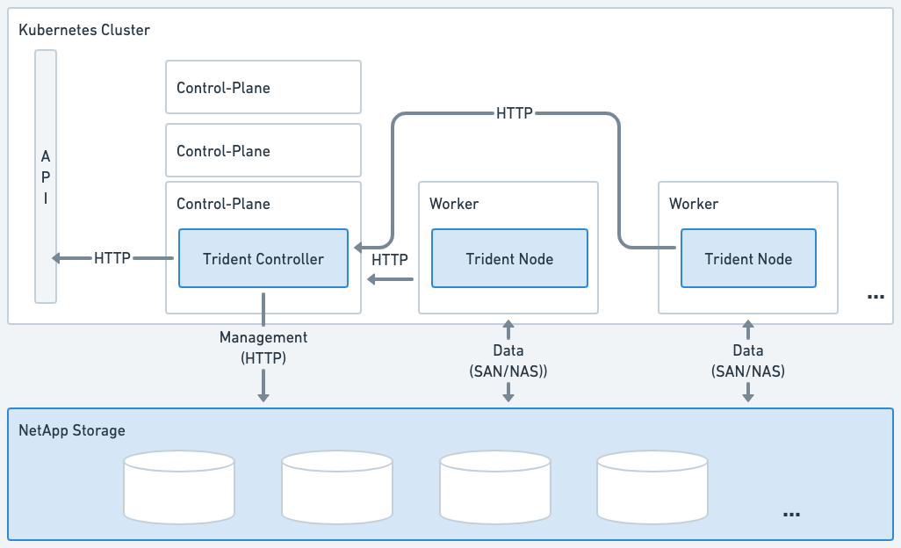
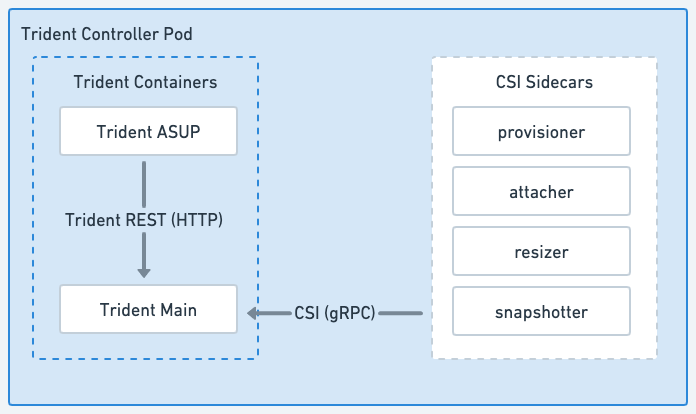
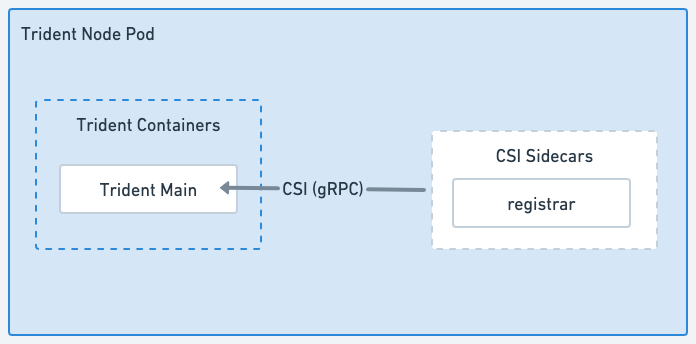

= Trident-Architektur
:hardbreaks:
:allow-uri-read: 
:icons: font
:imagesdir: ../media/

[role="lead"]
Trident läuft als einzelner Controller-Pod plus ein Node-Pod auf jedem Worker-Knoten im Cluster. Der Node-Pod muss auf jedem Host ausgeführt werden, auf dem Sie möglicherweise ein Trident Volume einbinden möchten.

[[understanding-controller-pods-and-node-pods]]
== Controller-Pods und Node-Pods verstehen

Trident wird als einzelner <<Trident Controller Pod>> und einer oder mehrere <<Trident Node Pods>> auf dem Kubernetes-Cluster bereitgestellt und verwendet standardmäßige Kubernetes , um die Bereitstellung von CSI-Plugins zu vereinfachen. link:https://kubernetes-csi.github.io/docs/sidecar-containers.html["Kubernetes CSI Sidecar Container"^] werden von der Kubernetes Storage Community gewartet.

Kubernetes link:https://kubernetes.io/docs/concepts/scheduling-eviction/assign-pod-node/["Knotenselektoren"^] und link:https://kubernetes.io/docs/concepts/scheduling-eviction/taint-and-toleration/["Tolerations und Taints"^] werden verwendet, um einen Pod auf einen bestimmten oder bevorzugten Knoten zu beschränken. Sie können Knotenselektoren und Toleranzen für Controller- und Knoten-Pods während der Trident-Installation konfigurieren.

* Das Controller-Plugin übernimmt die Bereitstellung und Verwaltung von Volumes, wie Snapshots und Größenänderungen.
* Das Node-Plugin übernimmt das Anbinden des Speichers an den Knoten.

.Trident wurde auf dem Kubernetes-Cluster bereitgestellt

[[trident-controller-pod]]
=== Trident Controller Pod

Der Trident Controller Pod ist ein einzelner Pod, auf dem das CSI Controller Plugin ausgeführt wird.

* Verantwortlich für die Bereitstellung und Verwaltung von Volumes im NetApp Storage
* Verwaltet durch eine Kubernetes Deployment
* Kann je nach Installationsparametern auf den Steuerungsebene- oder Arbeitsknoten ausgeführt werden.

.Trident Controller Pod-Diagramm

[[trident-node-pods]]
=== Trident Node Pods

Trident Node Pods sind privilegierte Pods, auf denen das CSI Node Plugin ausgeführt wird.

* Verantwortlich für das Ein- und Aushängen von Storage für Pods, die auf dem Host ausgeführt werden
* Verwaltet von einem Kubernetes DaemonSet
* Muss auf jedem Knoten ausgeführt werden, der NetApp Storage einbinden wird

.Trident Node Pod Diagramm

[[supported-kubernetes-cluster-architectures]]
== Unterstützte Kubernetes-Clusterarchitekturen

Trident wird mit den folgenden Kubernetes-Architekturen unterstützt:

[cols="3,1,2"]
|===
| Kubernetes-Clusterarchitekturen | Unterstützt | Standardinstallation 

| Einzelner Master, Compute | Ja  a| 
Ja

| Mehrere Master, Compute | Ja  a| 
Ja

| Meister, `etcd`, berechnen | Ja  a| 
Ja

| Master, Infrastruktur, Compute | Ja  a| 
Ja

|===