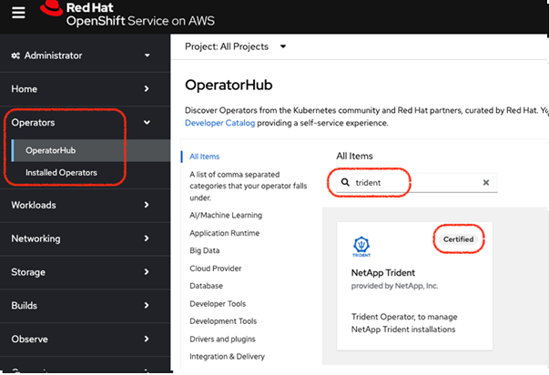
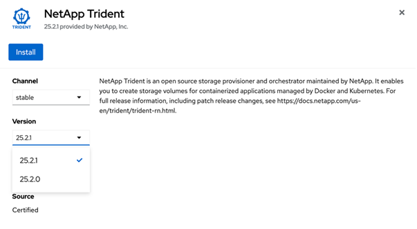
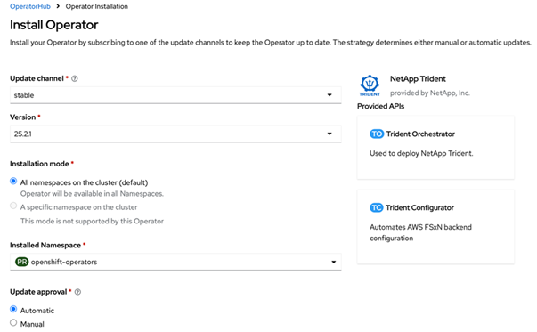
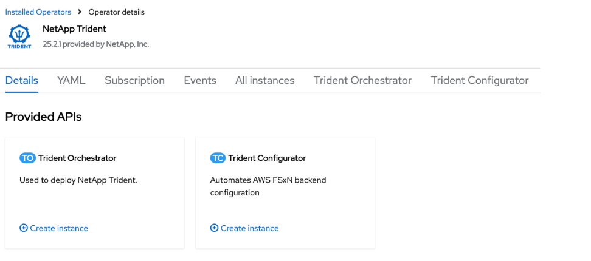
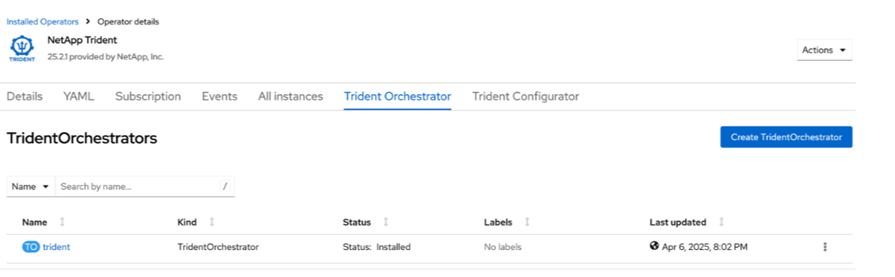

= Installieren Sie Trident mit OpenShift OperatorHub
:hardbreaks:
:allow-uri-read: 
:icons: font
:imagesdir: ../media/

[role="lead"]
Wenn Sie Red Hat OpenShift verwenden, können Sie NetApp Trident mithilfe des von Red Hat zertifizierten Operators installieren. Verwenden Sie dieses Verfahren, um Trident von der Red Hat OpenShift Container Platform zu installieren.

.Bevor Sie beginnen
Bevor Sie mit der Installation beginnen, link:../trident-get-started/requirements.html["Bereiten Sie Ihre Umgebung für die Trident Installation vor"].

[[find-and-install-the-trident-operator]]
== Suchen und installieren Sie den Trident Operator

.Schritte
. Navigieren Sie zu OpenShift OperatorHub und suchen Sie nach NetApp Trident.
+

. Klicken Sie auf *NetApp Trident*, um die Installationseinstellungen zu öffnen.
. Wählen Sie die gewünschten Optionen aus und klicken Sie auf *Install*, um die Operator-Konfiguration zu öffnen.
+

+

NOTE: Stellen Sie sicher, dass Sie die aktuellste Operator-Version auswählen.

. Behalten Sie alle Parameter bei und klicken Sie auf *Install*.
+

. Klicken Sie auf *View Operator*, um die Details des Operators anzuzeigen.
+

. Klicken Sie auf *YAML view* und fügen Sie Folgendes in das Formular ein:
+
[source, yaml]
----
apiVersion: trident.netapp.io/v1
kind: TridentOrchestrator
metadata:
  name: trident
  namespace: openshift-operators
spec:
  IPv6: false
  debug: false
  nodePrep:
  - iscsi
  imageRegistry: ''
  k8sTimeout: 180s
  namespace: trident
  silenceAutosupport: false
----
+
[NOTE]
====
Die Benutzeroberfläche bietet ein Standardbeispiel. Sie können dieses direkt bearbeiten, anstatt eine vollständige Konfiguration zu kopieren.

====

[NOTE]
====
Optional: Gleichzeitigkeit aktivieren

Um Parallelverarbeitung zu ermöglichen, fügen Sie der Spezifikation das folgende Feld hinzu:

[source, yaml]
----
enableConcurrency: true
----
====
[NOTE]
====
* Red Hat Enterprise Linux CoreOS (RHCOS) hat iSCSI nicht aktiviert und konfiguriert.
* Sie können den  `nodePrep` Parameter hinzufügen, um sowohl iSCSI- als auch Multipath-Dienste auf allen OpenShift Worker-Knoten zu konfigurieren und zu aktivieren.
* Ab OpenShift 4.19 ist die minimale unterstützte Trident-Version für diese Funktion 25.06.1.

====
. Klicken Sie auf *Create*; der Trident Orchestrator wird vollständig installiert.
+

[[uninstall-trident-operator]]
== Trident Operator deinstallieren

.Schritte
. Wählen Sie den Trident Operator aus der Liste der installierten Operator aus.
. Wählen Sie aus, wenn Sie alle Operandeninstanzen aus dem Operator löschen möchten.
+

WARNING: Wenn Sie das Kontrollkästchen *Alle Operandeninstanzen dieses Operators löschen* nicht auswählen, wird Trident nicht deinstalliert.

. Klicken Sie auf *Uninstall*.

