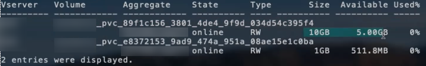

= ONTAP NAS-Konfigurationsoptionen und Beispiele
:hardbreaks:
:allow-uri-read: 
:icons: font
:imagesdir: ../media/

[role="lead"]
ONTAP NAS-Treiber können mit Ihrer Trident Installation erstellt und verwendet werden. Dieser Abschnitt enthält Beispiele für die Backend-Konfiguration und Details zur Zuordnung von Backends zu StorageClasses. Ab der Version 25.10 unterstützt NetApp Trident link:https://docs.netapp.com/us-en/ontap-afx/index.html["NetApp AFX-Speichersysteme"^]. NetApp AFX-Speichersysteme unterscheiden sich von anderen ONTAP-basierten Systemen (ASA, AFF und FAS) in der Implementierung ihrer Speicherschicht.

NOTE: Nur der `ontap-nas` Treiber (mit NFS-Protokoll) wird für NetApp AFX-Systeme unterstützt; das SMB-Protokoll wird nicht unterstützt.

[[backend-configuration-options]]
== Backend-Konfigurationsoptionen

In der Trident-Backend-Konfiguration müssen Sie nicht angeben, dass Ihr System ein NetApp AFX-Speichersystem ist. Wenn Sie  `ontap-nas` als  `storageDriverName` auswählen, erkennt Trident das AFX-Speichersystem automatisch. Einige Backend-Konfigurationsparameter sind für AFX-Speichersysteme nicht anwendbar.

Ab der Version 26.06 kann die ONTAP Balanced Placement-Funktion aktiviert werden, sodass ONTAP das Aggregat für neue Volumes auswählt. Balanced Placement ist für AFX Storage-Systeme mit ONTAP 9.19.1 oder neuer erforderlich. Siehe link:ontap-balanced-placement.html["Ausgewogene Platzierung mit ONTAP Backends verwenden"] für Anforderungen und Beispiele.

Die folgende Tabelle zeigt die Backend-Konfigurationsoptionen:

[cols="1,3,2"]
|===
| Parameter | Beschreibung | Standard 

| `version` |  | Immer 1 

| `storageDriverName`  a| 
Name des Speichertreibers.

Kann nach der Erstellung nicht mehr geändert werden. Zum Aktualisieren dieses Parameters ist die Erstellung eines neuen Backends erforderlich.

NOTE: Für NetApp AFX-Systeme wird nur  `ontap-nas` unterstützt.
| `ontap-nas`, `ontap-nas-economy`, oder `ontap-nas-flexgroup` 

| `backendName` | Benutzerdefinierter Name oder das Speicher-Backend | Treibername + "_" + dataLIF 

| `managementLIF` | IP-Adresse eines Clusters oder einer SVM-Management-LIF. Ein vollqualifizierter Domänenname (FQDN) kann angegeben werden. Kann so eingestellt werden, dass IPv6-Adressen verwendet werden, wenn Trident mit dem IPv6-Flag installiert wurde. IPv6-Adressen müssen in eckigen Klammern angegeben werden, wie  `[28e8:d9fb:a825:b7bf:69a8:d02f:9e7b:3555]`. Für einen reibungslosen MetroCluster-Switchover siehe <<mcc-best>>. | "10.0.0.1", "[2001:1234:abcd::fefe]" 

| `dataLIF` | IP-Adresse des Protokoll-LIF. NetApp empfiehlt,  `dataLIF` anzugeben. Falls nicht angegeben, ruft Trident dataLIFs vom SVM ab. Ein vollqualifizierter Domainname (FQDN) kann für die NFS-Mount-Operationen angegeben werden, wodurch die Erstellung eines Round-Robin-DNS zur Lastverteilung über mehrere dataLIFs ermöglicht wird. Kann nach der Ersteinrichtung geändert werden. Weitere Informationen enthält . Kann so eingestellt werden, dass IPv6-Adressen verwendet werden, wenn Trident mit dem IPv6-Flag installiert wurde. IPv6-Adressen müssen in eckigen Klammern angegeben werden, wie  `[28e8:d9fb:a825:b7bf:69a8:d02f:9e7b:3555]`. *Für MetroCluster weglassen.* Siehe <<mcc-best>>. | Angegebene Adresse oder abgeleitet von SVM, falls nicht angegeben (nicht empfohlen) 

| `svm` | Zu verwendende virtuelle Speichermaschine *Für MetroCluster auslassen.* Siehe <<mcc-best>>. | Wird abgeleitet, wenn eine SVM `managementLIF` angegeben ist 

| `autoExportPolicy` | Automatische Erstellung und Aktualisierung von Exportrichtlinien aktivieren [Boolean]. Mit den Optionen `autoExportPolicy` und `autoExportCIDRs` kann Trident Exportrichtlinien automatisch verwalten. | false 

| `autoExportCIDRs` | Liste der CIDRs, anhand derer die Node-IPs von Kubernetes gefiltert werden, wenn `autoExportPolicy` aktiviert ist. Mit den Optionen `autoExportPolicy` und `autoExportCIDRs` kann Trident Exportrichtlinien automatisch verwalten. | ["0.0.0.0/0", "::/0"]` 

| `labels` | Satz beliebiger JSON-formatierter Bezeichnungen, die auf Volumes angewendet werden sollen | "" 

| `clientCertificate` | Base64-kodierter Wert des Clientzertifikats. Wird für zertifikatbasierte Authentifizierung verwendet | "" 

| `clientPrivateKey` | Base64-kodierter Wert des privaten Client-Schlüssels. Wird für zertifikatbasierte Authentifizierung verwendet | "" 

| `trustedCACertificate` | Base64-kodierter Wert des vertrauenswürdigen CA-Zertifikats. Optional. Wird für zertifikatbasierte Authentifizierung verwendet | "" 

| `username` | Benutzername für die Verbindung zum Cluster/SVM. Wird für die anmeldeinformationsbasierte Authentifizierung verwendet. Für die Active Directory Authentifizierung siehe link:../trident-use/ontap-san-examples.html#authenticate-trident-to-a-backend-svm-using-active-directory-credentials["Authentifizieren Sie Trident bei einer Backend-SVM mit Active Directory-Anmeldeinformationen"]. |  

| `password` | Passwort für die Verbindung zum Cluster/SVM. Wird für die anmeldeinformationsbasierte Authentifizierung verwendet. Für die Active Directory Authentifizierung siehe link:../trident-use/ontap-san-examples.html#authenticate-trident-to-a-backend-svm-using-active-directory-credentials["Authentifizieren Sie Trident bei einer Backend-SVM mit Active Directory-Anmeldeinformationen"]. |  

| `storagePrefix`  a| 
Präfix, das beim Bereitstellen neuer Volumes in der SVM verwendet wird. Kann nach der Festlegung nicht mehr geändert werden.

NOTE: Bei Verwendung von ontap-nas-economy und einem storagePrefix, der 24 oder mehr Zeichen umfasst, ist das Speicherpräfix nicht in die Qtrees eingebettet, obwohl es im Volume-Namen enthalten ist.
| "Trident" 

| `aggregate`  a| 
Aggregat für die Bereitstellung (optional; falls festgelegt, muss es der SVM zugewiesen werden). Für den  `ontap-nas-flexgroup` Treiber wird diese Option ignoriert. Wenn kein Aggregat zugewiesen ist, kann jedes der verfügbaren Aggregate zur Bereitstellung eines FlexGroup Volumes verwendet werden.

NOTE: Wird das Aggregat in SVM aktualisiert, erfolgt die Aktualisierung in Trident automatisch durch regelmäßiges Abfragen von SVM, ohne dass der Trident Controller neu gestartet werden muss. Wenn in Trident ein bestimmtes Aggregat für die Volume-Bereitstellung konfiguriert wurde und dieses Aggregat umbenannt oder aus der SVM verschoben wird, wechselt das Backend in Trident beim Abfragen des SVM-Aggregats in den Fehlerzustand. Das Aggregat muss entweder auf eines geändert werden, das in der SVM vorhanden ist, oder vollständig entfernt werden, damit das Backend wieder online ist.

*Nicht für AFX storage systems angeben.*

*Nicht angeben, wenn  `useBalancedPlacement` auf  `true` gesetzt ist.*
 a| 
""

| `useBalancedPlacement`  a| 
Aggregatauswahl für neue Volumes an ONTAP [Boolescher Wert]. Erfordert ONTAP 9.19.1 oder höher und  `useREST` auf  `true` gesetzt. Kann nicht mit  `aggregate` kombiniert werden.

Siehe link:ontap-balanced-placement.html["Ausgewogene Platzierung mit ONTAP Backends verwenden"] für Anforderungen und Beispiele.

*Falls angegeben, immer auf  `true` für AFX Storage-Systeme unter ONTAP 9.19.1 oder höher setzen.*
| `false`; `true` für AFX Speichersysteme auf ONTAP 9.19.1 oder höher 

| `limitAggregateUsage` | Die Bereitstellung schlägt fehl, wenn die Nutzung diesen Prozentsatz überschreitet. *Gilt nicht für Amazon FSx for ONTAP*. *Nicht für AFX storage systems angeben.* | "" (wird nicht standardmäßig erzwungen) 

| flexgroupAggregateList  a| 
Liste der Aggregate für die Bereitstellung (optional; falls festgelegt, muss sie der SVM zugewiesen werden). Alle Aggregate, die der SVM zugewiesen sind, werden zur Bereitstellung eines FlexGroup-Volumes verwendet. Unterstützt für den *ontap-nas-flexgroup*-Speichertreiber.

NOTE: Wird die Aggregatliste in SVM aktualisiert, wird sie in Trident automatisch durch Abfrage von SVM aktualisiert, ohne dass der Trident Controller neu gestartet werden muss. Wenn in Trident eine bestimmte Aggregatliste für die Volume-Bereitstellung konfiguriert wurde und diese Aggregatliste umbenannt oder aus SVM verschoben wird, wechselt das Backend in Trident beim Abfragen der SVM-Aggregatliste in den Fehlerzustand. Entweder muss die Aggregatliste durch eine in SVM vorhandene ersetzt oder vollständig entfernt werden, damit das Backend wieder online ist.
| "" 

| `limitVolumeSize` | Die Bereitstellung schlägt fehl, wenn die angeforderte Volume-Größe diesen Wert überschreitet. | "" (wird nicht standardmäßig erzwungen) 

| `debugTraceFlags` | Debug-Flags zur Verwendung bei der Fehlersuche. Beispiel, {"api":false, "method":true} Verwenden Sie  `debugTraceFlags` nicht, es sei denn, Sie führen eine Fehlersuche durch und benötigen eine detaillierte Protokollausgabe. | null 

| `nasType` | Konfigurieren Sie die Erstellung von NFS- oder SMB-Volumes. Optionen sind `nfs`, `smb` oder null. Die Einstellung auf null verwendet standardmäßig NFS-Volumes. *Falls angegeben, immer auf `nfs` für AFX-Speichersysteme setzen.* | `nfs` 

| `nfsMountOptions` | Kommagetrennte Liste der NFS-Mountoptionen. Die Mountoptionen für Kubernetes-persistente Volumes werden normalerweise in Speicherklassen angegeben, aber wenn in einer Speicherklasse keine Mountoptionen angegeben sind, greift Trident auf die Mountoptionen zurück, die in der Konfigurationsdatei des Storage-Backends angegeben sind. Wenn weder in der Speicherklasse noch in der Konfigurationsdatei Mountoptionen angegeben sind, setzt Trident keine Mountoptionen für das zugehörige persistente Volume. | "" 

| `qtreesPerFlexvol` | Maximale Qtrees pro FlexVol, muss im Bereich [50, 300] liegen | "200" 

| `smbShare` | Sie können eines der folgenden angeben: den Namen einer SMB-Freigabe, die mit der Microsoft Management Console oder ONTAP CLI erstellt wurde; einen Namen, damit Trident die SMB-Freigabe erstellen kann; oder Sie können den Parameter leer lassen, um den gemeinsamen Freigabezugriff auf Volumes zu verhindern. Dieser Parameter ist optional für lokale ONTAP. Dieser Parameter ist für Amazon FSx for ONTAP Backends erforderlich und darf nicht leer sein. | `smb-share` 

| `useREST` | Boolescher Parameter zur Verwendung von ONTAP REST APIs.  `useREST` Wenn auf `true` gesetzt, verwendet Trident ONTAP REST APIs zur Kommunikation mit dem Backend; wenn auf `false` gesetzt, verwendet Trident ONTAPI (ZAPI)-Aufrufe zur Kommunikation mit dem Backend. Diese Funktion erfordert ONTAP 9.11.1 und höher. Zusätzlich muss die verwendete ONTAP-Anmelderolle Zugriff auf die `ontapi` Anwendung haben. Dies wird durch die vordefinierten `vsadmin` und `cluster-admin` Rollen erfüllt. Ab der Trident 24.06-Version und ONTAP 9.15.1 oder höher ist `useREST` standardmäßig auf `true` gesetzt; ändern Sie `useREST` auf `false`, um ONTAPI (ZAPI)-Aufrufe zu verwenden. *Falls angegeben, immer auf `true` für AFX-Speichersysteme setzen.* | `true` für ONTAP 9.15.1 oder höher, andernfalls  `false`. 

| `limitVolumePoolSize` | Maximal anforderbare FlexVol-Größe bei Verwendung von Qtrees im ontap-nas-economy Backend. | "" (wird nicht standardmäßig erzwungen) 

| `denyNewVolumePools` | Beschränkt `ontap-nas-economy` Backends darauf, neue FlexVol Volumes zu erstellen, um ihre Qtrees zu enthalten. Für die Bereitstellung neuer PVs werden ausschließlich bereits vorhandene FlexVols verwendet. |  

| `adAdminUser` | Active Directory-Administratorbenutzer oder -Benutzergruppe mit vollem Zugriff auf SMB-Freigaben. Verwenden Sie diesen Parameter, um Administratorrechte für die SMB-Freigabe mit vollständiger Kontrolle zu erteilen. |  
|===

[[backend-configuration-options-for-provisioning-volumes]]
== Backend-Konfigurationsoptionen für die Bereitstellung von Volumes

Sie können die Standardbereitstellung mithilfe dieser Optionen im  `defaults` Abschnitt der Konfiguration steuern. Ein Beispiel finden Sie in den unten stehenden Konfigurationsbeispielen.

[cols="1,3,2"]
|===
| Parameter | Beschreibung | Standard 

| `spaceAllocation` | Speicherplatzzuweisung für Qtrees | "true" 

| `spaceReserve` | Platzreservierungsmodus; "none" (dünn) oder "volume" (dick) | "none" 

| `snapshotPolicy` | Zu verwendende Snapshot-Richtlinie | "none" 

| `qosPolicy` | QoS-Richtliniengruppe, die für erstellte Volumes zugewiesen werden soll. Wählen Sie eine der qosPolicy oder adaptiveQosPolicy pro Speicherpool/Backend aus. | "" 

| `adaptiveQosPolicy` | Adaptive QoS-Richtliniengruppe zur Zuweisung für erstellte Volumes. Wählen Sie eine von qosPolicy oder adaptiveQosPolicy pro Storage-Pool/Backend. Wird von ontap-nas-economy nicht unterstützt. | "" 

| `snapshotReserve` | Prozentsatz des für Snapshots reservierten Volumens | "0", falls  `snapshotPolicy`"none", andernfalls "" 

| `splitOnClone` | Trennen Sie einen Klon bei seiner Erstellung von seinem übergeordneten Objekt | "false" 

| `encryption` | Aktivieren Sie NetApp Volume Encryption (NVE) auf dem neuen Volume; standardmäßig  `false`. NVE muss auf dem Cluster lizenziert und aktiviert sein, damit diese Option verwendet werden kann. Wenn NAE im Backend aktiviert ist, ist jedes in Trident bereitgestellte Volume NAE-aktiviert. Weitere Informationen unter: link:../trident-reco/security-reco.html["Wie Trident mit NVE und NAE zusammenarbeitet"]. | "false" 

| `tieringPolicy` | Tiering-Richtlinie auf "none" setzen |  

| `unixPermissions` | Modus für neue Volumes | "777" für NFS-Volumes; leer (nicht zutreffend) für SMB-Volumes 

| `snapshotDir` | Steuert den Zugriff auf das `.snapshot` Verzeichnis | `true`, `false` (explizit festlegen). 

| `exportPolicy` | Zu verwendende Exportrichtlinie | "default" 

| `securityStyle` | Sicherheitsstil für neue Volumes. NFS unterstützt `mixed` und `unix` Sicherheitsstile. SMB unterstützt `mixed` und `ntfs` Sicherheitsstile. | NFS-Standard ist `unix`. SMB-Standard ist `ntfs`. 

| `nameTemplate` | Vorlage zum Erstellen benutzerdefinierter Volume-Namen. | "" 
|===

NOTE: Die Verwendung von QoS-Richtliniengruppen mit Trident erfordert ONTAP 9.8 oder höher. Sie sollten eine nicht gemeinsam genutzte QoS-Richtliniengruppe verwenden und sicherstellen, dass die Richtliniengruppe auf jede Komponente einzeln angewendet wird. Eine gemeinsam genutzte QoS-Richtliniengruppe erzwingt die Obergrenze für den Gesamtdurchsatz aller Workloads.

[[volume-provisioning-examples]]
=== Beispiele für die Volume-Bereitstellung

Hier ist ein Beispiel mit definierten Standardwerten:

[source, yaml]
----
---
version: 1
storageDriverName: ontap-nas
backendName: customBackendName
managementLIF: 10.0.0.1
dataLIF: 10.0.0.2
labels:
  k8scluster: dev1
  backend: dev1-nasbackend
svm: trident_svm
username: cluster-admin
password: <password>
limitAggregateUsage: 80%
limitVolumeSize: 50Gi
nfsMountOptions: nfsvers=4
debugTraceFlags:
  api: false
  method: true
defaults:
  spaceReserve: volume
  qosPolicy: premium
  exportPolicy: myk8scluster
  snapshotPolicy: default
  snapshotReserve: "10"
----
Für  `ontap-nas` und  `ontap-nas-flexgroups` verwendet Trident nun eine neue Berechnung, um sicherzustellen, dass die FlexVol mit dem snapshotReserve-Prozentsatz und dem PVC korrekt dimensioniert ist. Wenn der Benutzer einen PVC anfordert, erstellt Trident das ursprüngliche FlexVol mit mehr Speicherplatz mithilfe der neuen Berechnung. Diese Berechnung stellt sicher, dass der Benutzer den beschreibbaren Speicherplatz erhält, den er im PVC angefordert hat, und nicht weniger als angefordert. Vor v21.07, wenn der Benutzer einen PVC anfordert (zum Beispiel 5 GiB) und der snapshotReserve auf 50 Prozent gesetzt ist, erhält er nur 2,5 GiB beschreibbaren Speicherplatz. Dies liegt daran, dass das, was der Benutzer anfordert, das gesamte Volume ist und  `snapshotReserve` ein Prozentsatz davon ist. Mit Trident 21.07 ist das, was der Benutzer anfordert, der beschreibbare Speicherplatz, und Trident definiert die  `snapshotReserve` Zahl als Prozentsatz des gesamten Volumens. Dies gilt nicht für  `ontap-nas-economy`. Siehe das folgende Beispiel, um zu sehen, wie dies funktioniert:

Die Berechnung erfolgt wie folgt:

[listing]
----
Total volume size = <PVC requested size> / (1 - (<snapshotReserve percentage> / 100))
----
Für snapshotReserve = 50 %, und eine PVC-Anforderung = 5 GiB, beträgt die Gesamtgröße des Volumes 5/0,5 = 10 GiB und die verfügbare Größe 5 GiB, was der vom Benutzer in der PVC-Anforderung angeforderten Größe entspricht. Der  `volume show`-Befehl sollte Ergebnisse ähnlich diesem Beispiel anzeigen:

Bestehende Backends aus früheren Installationen stellen Volumes wie oben beschrieben bereit, wenn Trident aktualisiert wird. Für Volumes, die vor dem Upgrade erstellt wurden, sollte deren Größe angepasst werden, damit die Änderung wirksam wird. Beispielsweise führte ein 2-GiB-PVC mit  `snapshotReserve=50` zuvor zu einem Volume, das 1 GiB beschreibbaren Speicherplatz bereitstellt. Eine Größenänderung des Volumes auf beispielsweise 3 GiB stellt der Anwendung 3 GiB beschreibbaren Speicherplatz auf einem 6-GiB-Volume zur Verfügung.

[[minimal-configuration-examples]]
== Minimale Konfigurationsbeispiele

Die folgenden Beispiele zeigen Basiskonfigurationen, bei denen die meisten Parameter auf Standardwerte eingestellt sind. Dies ist die einfachste Methode, ein Backend zu definieren.

NOTE: Wenn Sie Amazon FSx auf NetApp ONTAP mit Trident verwenden, wird empfohlen, für LIFs DNS-Namen anstelle von IP-Adressen anzugeben.

.ONTAP NAS economy Beispiel
[%collapsible]
====
[source, yaml]
----
---
version: 1
storageDriverName: ontap-nas-economy
managementLIF: 10.0.0.1
dataLIF: 10.0.0.2
svm: svm_nfs
username: vsadmin
password: password
----
====
.ONTAP NAS FlexGroup-Beispiel
[%collapsible]
====
[source, yaml]
----
---
version: 1
storageDriverName: ontap-nas-flexgroup
managementLIF: 10.0.0.1
dataLIF: 10.0.0.2
svm: svm_nfs
username: vsadmin
password: password
----
====
.MetroCluster Beispiel
[#mcc-best%collapsible]
====
Sie können das Backend so konfigurieren, dass Sie die Backend-Definition nach einem Switchover und Switchback während link:../trident-reco/backup.html#svm-replication-and-recovery["SVM-Replikation und -Wiederherstellung"] nicht manuell aktualisieren müssen.

Für einen nahtlosen Switchover und Switchback geben Sie die SVM mit  `managementLIF` an und lassen Sie die  `dataLIF` und  `svm` Parameter weg. Beispiel:

[source, yaml]
----
---
version: 1
storageDriverName: ontap-nas
managementLIF: 192.168.1.66
username: vsadmin
password: password
----
====
.Beispiel für SMB-Volumes
[%collapsible]
====
[source, yaml]
----
---
version: 1
backendName: ExampleBackend
storageDriverName: ontap-nas
managementLIF: 10.0.0.1
nasType: smb
securityStyle: ntfs
unixPermissions: ""
dataLIF: 10.0.0.2
svm: svm_nfs
username: vsadmin
password: password
----
====
.Beispiel für zertifikatsbasierte Authentifizierung
[%collapsible]
====
Dies ist ein minimales Beispiel für eine Backend-Konfiguration. `clientCertificate`, `clientPrivateKey` und `trustedCACertificate` (optional, falls eine vertrauenswürdige Zertifizierungsstelle verwendet wird) werden in `backend.json` befüllt und nehmen die Base64-kodierten Werte des Clientzertifikats, des privaten Schlüssels und des Zertifikats der vertrauenswürdigen Zertifizierungsstelle an.

[source, yaml]
----
---
version: 1
backendName: DefaultNASBackend
storageDriverName: ontap-nas
managementLIF: 10.0.0.1
dataLIF: 10.0.0.15
svm: nfs_svm
clientCertificate: ZXR0ZXJwYXB...ICMgJ3BhcGVyc2
clientPrivateKey: vciwKIyAgZG...0cnksIGRlc2NyaX
trustedCACertificate: zcyBbaG...b3Igb3duIGNsYXNz
storagePrefix: myPrefix_
----
====
.Beispiel für eine automatische Exportrichtlinie
[%collapsible]
====
Dieses Beispiel zeigt Ihnen, wie Sie Trident anweisen können, dynamische Exportrichtlinien zu verwenden, um die Exportrichtlinie automatisch zu erstellen und zu verwalten. Dies funktioniert gleichermaßen für die `ontap-nas-economy` und `ontap-nas-flexgroup` Treiber.

[source, yaml]
----
---
version: 1
storageDriverName: ontap-nas
managementLIF: 10.0.0.1
dataLIF: 10.0.0.2
svm: svm_nfs
labels:
  k8scluster: test-cluster-east-1a
  backend: test1-nasbackend
autoExportPolicy: true
autoExportCIDRs:
- 10.0.0.0/24
username: admin
password: password
nfsMountOptions: nfsvers=4
----
====
.Beispiel für eine ausgewogene Platzierung
[%collapsible]
====
Dieses Beispiel aktiviert die ausgewogene Platzierung in ONTAP, sodass ONTAP das Aggregat für neue Volumes auswählt. Die ausgewogene Platzierung erfordert ONTAP 9.19.1 oder höher. Details sind in link:ontap-balanced-placement.html["Ausgewogene Platzierung mit ONTAP Backends verwenden"] zu finden.

[source, yaml]
----
---
version: 1
storageDriverName: ontap-nas
backendName: nas-balanced-placement
managementLIF: 10.0.0.1
dataLIF: 10.0.0.2
svm: svm_nfs
username: vsadmin
password: password
useBalancedPlacement: true
----
====
.Beispiel für IPv6 addresses
[%collapsible]
====
Dieses Beispiel zeigt `managementLIF` die Verwendung einer IPv6-Adresse.

[source, yaml]
----
---
version: 1
storageDriverName: ontap-nas
backendName: nas_ipv6_backend
managementLIF: "[5c5d:5edf:8f:7657:bef8:109b:1b41:d491]"
labels:
  k8scluster: test-cluster-east-1a
  backend: test1-ontap-ipv6
svm: nas_ipv6_svm
username: vsadmin
password: password
----
====
.Amazon FSx für ONTAP mit SMB-Volumes Beispiel
[%collapsible]
====
Der  `smbShare` Parameter ist für FSx for ONTAP mit SMB-Volumes erforderlich.

[source, yaml]
----
---
version: 1
backendName: SMBBackend
storageDriverName: ontap-nas
managementLIF: example.mgmt.fqdn.aws.com
nasType: smb
dataLIF: 10.0.0.15
svm: nfs_svm
smbShare: smb-share
clientCertificate: ZXR0ZXJwYXB...ICMgJ3BhcGVyc2
clientPrivateKey: vciwKIyAgZG...0cnksIGRlc2NyaX
trustedCACertificate: zcyBbaG...b3Igb3duIGNsYXNz
storagePrefix: myPrefix_
----
====
.Beispiel für die Backend-Konfiguration mit nameTemplate
[%collapsible]
====
[source, yaml]
----
---
version: 1
storageDriverName: ontap-nas
backendName: ontap-nas-backend
managementLIF: <ip address>
svm: svm0
username: <admin>
password: <password>
defaults:
  nameTemplate: "{{.volume.Name}}_{{.labels.cluster}}_{{.volume.Namespace}}_{{.vo\
    lume.RequestName}}"
labels:
  cluster: ClusterA
  PVC: "{{.volume.Namespace}}_{{.volume.RequestName}}"
----
====

[[examples-of-backends-with-virtual-pools]]
== Beispiele für Backends mit virtuellen Pools

In den unten gezeigten Beispiel-Backend-Definitionsdateien sind für alle Speicherpools spezifische Standardwerte festgelegt, wie  `spaceReserve` bei none,  `spaceAllocation` bei false und  `encryption` bei false. Die virtuellen Pools werden im Speicherabschnitt definiert.

Trident legt Bereitstellungsbezeichnungen im Feld „Kommentare“ fest. Kommentare werden auf FlexVol für  `ontap-nas` oder auf FlexGroup für  `ontap-nas-flexgroup` festgelegt. Trident kopiert alle auf einem virtuellen Pool vorhandenen Bezeichnungen bei der Bereitstellung auf das Speichervolume. Zur Vereinfachung können Speicheradministratoren Bezeichnungen pro virtuellem Pool definieren und Volumes nach Bezeichnung gruppieren.

In diesen Beispielen legen einige Speicherpools ihre eigenen `spaceReserve`, `spaceAllocation`, und `encryption` Werte fest, und einige Pools überschreiben die Standardwerte.

.ONTAP NAS-Beispiel
[%collapsible%open]
====
[source, yaml]
----
---
version: 1
storageDriverName: ontap-nas
managementLIF: 10.0.0.1
svm: svm_nfs
username: admin
password: <password>
nfsMountOptions: nfsvers=4
defaults:
  spaceReserve: none
  encryption: "false"
  qosPolicy: standard
labels:
  store: nas_store
  k8scluster: prod-cluster-1
region: us_east_1
storage:
  - labels:
      app: msoffice
      cost: "100"
    zone: us_east_1a
    defaults:
      spaceReserve: volume
      encryption: "true"
      unixPermissions: "0755"
      adaptiveQosPolicy: adaptive-premium
  - labels:
      app: slack
      cost: "75"
    zone: us_east_1b
    defaults:
      spaceReserve: none
      encryption: "true"
      unixPermissions: "0755"
  - labels:
      department: legal
      creditpoints: "5000"
    zone: us_east_1b
    defaults:
      spaceReserve: none
      encryption: "true"
      unixPermissions: "0755"
  - labels:
      app: wordpress
      cost: "50"
    zone: us_east_1c
    defaults:
      spaceReserve: none
      encryption: "true"
      unixPermissions: "0775"
  - labels:
      app: mysqldb
      cost: "25"
    zone: us_east_1d
    defaults:
      spaceReserve: volume
      encryption: "false"
      unixPermissions: "0775"

----
====
.ONTAP NAS FlexGroup Beispiel
[%collapsible%open]
====
[source, yaml]
----
---
version: 1
storageDriverName: ontap-nas-flexgroup
managementLIF: 10.0.0.1
svm: svm_nfs
username: vsadmin
password: <password>
defaults:
  spaceReserve: none
  encryption: "false"
labels:
  store: flexgroup_store
  k8scluster: prod-cluster-1
region: us_east_1
storage:
  - labels:
      protection: gold
      creditpoints: "50000"
    zone: us_east_1a
    defaults:
      spaceReserve: volume
      encryption: "true"
      unixPermissions: "0755"
  - labels:
      protection: gold
      creditpoints: "30000"
    zone: us_east_1b
    defaults:
      spaceReserve: none
      encryption: "true"
      unixPermissions: "0755"
  - labels:
      protection: silver
      creditpoints: "20000"
    zone: us_east_1c
    defaults:
      spaceReserve: none
      encryption: "true"
      unixPermissions: "0775"
  - labels:
      protection: bronze
      creditpoints: "10000"
    zone: us_east_1d
    defaults:
      spaceReserve: volume
      encryption: "false"
      unixPermissions: "0775"

----
====
.ONTAP NAS economy Beispiel
[%collapsible%open]
====
[source, yaml]
----
---
version: 1
storageDriverName: ontap-nas-economy
managementLIF: 10.0.0.1
svm: svm_nfs
username: vsadmin
password: <password>
defaults:
  spaceReserve: none
  encryption: "false"
labels:
  store: nas_economy_store
region: us_east_1
storage:
  - labels:
      department: finance
      creditpoints: "6000"
    zone: us_east_1a
    defaults:
      spaceReserve: volume
      encryption: "true"
      unixPermissions: "0755"
  - labels:
      protection: bronze
      creditpoints: "5000"
    zone: us_east_1b
    defaults:
      spaceReserve: none
      encryption: "true"
      unixPermissions: "0755"
  - labels:
      department: engineering
      creditpoints: "3000"
    zone: us_east_1c
    defaults:
      spaceReserve: none
      encryption: "true"
      unixPermissions: "0775"
  - labels:
      department: humanresource
      creditpoints: "2000"
    zone: us_east_1d
    defaults:
      spaceReserve: volume
      encryption: "false"
      unixPermissions: "0775"

----
====

[[map-backends-to-storageclasses]]
== Backends zu StorageClasses zuordnen

Die folgenden StorageClass-Definitionen beziehen sich auf <<Beispiele für Backends mit virtuellen Pools>>. Mit dem  `parameters.selector`-Feld wird bei jeder StorageClass angegeben, welche virtuellen Pools zum Hosten eines Volumes verwendet werden können. Das Volume besitzt die im gewählten virtuellen Pool definierten Aspekte.

* Die `protection-gold` StorageClass wird den ersten und zweiten virtuellen Pool im `ontap-nas-flexgroup` Backend zugeordnet. Nur diese beiden Pools bieten Schutz auf Goldniveau.
+
[source, yaml]
----
apiVersion: storage.k8s.io/v1
kind: StorageClass
metadata:
  name: protection-gold
provisioner: csi.trident.netapp.io
parameters:
  selector: "protection=gold"
  fsType: "ext4"
----
* Die `protection-not-gold` StorageClass verweist auf den dritten und vierten virtuellen Pool im `ontap-nas-flexgroup` Backend. Dies sind die einzigen Pools, die ein anderes Schutzniveau als Gold bieten.
+
[source, yaml]
----
apiVersion: storage.k8s.io/v1
kind: StorageClass
metadata:
  name: protection-not-gold
provisioner: csi.trident.netapp.io
parameters:
  selector: "protection!=gold"
  fsType: "ext4"
----
* Die `app-mysqldb` StorageClass wird dem vierten virtuellen Pool im `ontap-nas` Backend zugeordnet. Dies ist der einzige Pool, der eine Speicherpoolkonfiguration für Anwendungen vom Typ mysqldb bietet.
+
[source, yaml]
----
apiVersion: storage.k8s.io/v1
kind: StorageClass
metadata:
  name: app-mysqldb
provisioner: csi.trident.netapp.io
parameters:
  selector: "app=mysqldb"
  fsType: "ext4"
----
* Die `protection-silver-creditpoints-20k` StorageClass verweist auf den dritten virtuellen Pool im `ontap-nas-flexgroup` Backend. Dies ist der einzige Pool, der Schutz auf Silber-Niveau und 20000 Kreditpunkte bietet.
+
[source, yaml]
----
apiVersion: storage.k8s.io/v1
kind: StorageClass
metadata:
  name: protection-silver-creditpoints-20k
provisioner: csi.trident.netapp.io
parameters:
  selector: "protection=silver; creditpoints=20000"
  fsType: "ext4"
----
* Die  `creditpoints-5k` StorageClass entspricht dem dritten virtuellen Pool im  `ontap-nas` Backend und dem zweiten virtuellen Pool im  `ontap-nas-economy` Backend. Dies sind die einzigen Poolangebote mit 5000 Kreditpunkten.
+
[source, yaml]
----
apiVersion: storage.k8s.io/v1
kind: StorageClass
metadata:
  name: creditpoints-5k
provisioner: csi.trident.netapp.io
parameters:
  selector: "creditpoints=5000"
  fsType: "ext4"
----

Trident entscheidet, welcher virtuelle Pool ausgewählt wird und stellt sicher, dass die Speicheranforderung erfüllt wird.

[[update-datalif-after-initial-configuration]]
== Aktualisieren `dataLIF` nach der Erstkonfiguration

Sie können die dataLIF nach der Erstkonfiguration ändern, indem Sie den folgenden Befehl ausführen, um die neue Backend-JSON-Datei mit der aktualisierten dataLIF bereitzustellen.

[listing]
----
tridentctl update backend <backend-name> -f <path-to-backend-json-file-with-updated-dataLIF>
----

NOTE: Wenn PVCs an einem oder mehreren Pods angeschlossen sind, müssen Sie alle entsprechenden Pods herunterfahren und anschließend wieder hochfahren, damit die neue dataLIF wirksam wird.

[[secure-smb-examples]]
== Beispiele für sicheres SMB

[[backend-configuration-with-ontap-nas-driver]]
=== Backend-Konfiguration mit dem ontap-nas-Treiber

[source, yaml]
----
apiVersion: trident.netapp.io/v1
kind: TridentBackendConfig
metadata:
  name: backend-tbc-ontap-nas
  namespace: trident
spec:
  version: 1
  storageDriverName: ontap-nas
  managementLIF: 10.0.0.1
  svm: svm2
  nasType: smb
  defaults:
    adAdminUser: tridentADtest
  credentials:
    name: backend-tbc-ontap-invest-secret
----

[[backend-configuration-with-ontap-nas-economy-driver]]
=== Backend-Konfiguration mit ontap-nas-economy-Treiber

[source, yaml]
----
apiVersion: trident.netapp.io/v1
kind: TridentBackendConfig
metadata:
  name: backend-tbc-ontap-nas
  namespace: trident
spec:
  version: 1
  storageDriverName: ontap-nas-economy
  managementLIF: 10.0.0.1
  svm: svm2
  nasType: smb
  defaults:
    adAdminUser: tridentADtest
  credentials:
    name: backend-tbc-ontap-invest-secret
----

[[backend-configuration-with-storage-pool]]
=== Backend-Konfiguration mit Speicherpool

[source, yaml]
----
apiVersion: trident.netapp.io/v1
kind: TridentBackendConfig
metadata:
  name: backend-tbc-ontap-nas
  namespace: trident
spec:
  version: 1
  storageDriverName: ontap-nas
  managementLIF: 10.0.0.1
  svm: svm0
  useREST: false
  storage:
  - labels:
      app: msoffice
    defaults:
      adAdminUser: tridentADuser
  nasType: smb
  credentials:
    name: backend-tbc-ontap-invest-secret

----

[[storage-class-example-with-ontap-nas-driver]]
=== Speicherklassenbeispiel mit dem ontap-nas-Treiber

[source, yaml]
----
apiVersion: storage.k8s.io/v1
kind: StorageClass
metadata:
  name: ontap-smb-sc
  annotations:
    trident.netapp.io/smbShareAdUserPermission: change
    trident.netapp.io/smbShareAdUser: tridentADtest
parameters:
  backendType: ontap-nas
  csi.storage.k8s.io/node-stage-secret-name: smbcreds
  csi.storage.k8s.io/node-stage-secret-namespace: trident
  trident.netapp.io/nasType: smb
provisioner: csi.trident.netapp.io
reclaimPolicy: Delete
volumeBindingMode: Immediate
----

NOTE: Stellen Sie sicher, dass Sie  `annotations` hinzufügen, um Secure SMB zu aktivieren. Secure SMB funktioniert ohne die Annotationen nicht, unabhängig von den im Backend oder PVC festgelegten Konfigurationen.

[[storage-class-example-with-ontap-nas-economy-driver]]
=== Speicherklassenbeispiel mit ontap-nas-economy-Treiber

[source, yaml]
----
apiVersion: storage.k8s.io/v1
kind: StorageClass
metadata:
  name: ontap-smb-sc
  annotations:
    trident.netapp.io/smbShareAdUserPermission: change
    trident.netapp.io/smbShareAdUser: tridentADuser3
parameters:
  backendType: ontap-nas-economy
  csi.storage.k8s.io/node-stage-secret-name: smbcreds
  csi.storage.k8s.io/node-stage-secret-namespace: trident
  trident.netapp.io/nasType: smb
provisioner: csi.trident.netapp.io
reclaimPolicy: Delete
volumeBindingMode: Immediate
----

[[pvc-example-with-a-single-ad-user]]
=== PVC-Beispiel mit einem einzelnen AD-Benutzer

[source, yaml]
----
apiVersion: v1
kind: PersistentVolumeClaim
metadata:
  name: my-pvc4
  namespace: trident
  annotations:
    trident.netapp.io/smbShareAccessControl: |
      change:
        - tridentADtest
      read:
        - tridentADuser
spec:
  accessModes:
    - ReadWriteOnce
  resources:
    requests:
      storage: 1Gi
  storageClassName: ontap-smb-sc
----

[[pvc-example-with-multiple-ad-users]]
=== PVC-Beispiel mit mehreren AD-Benutzern

[source, yaml]
----
apiVersion: v1
kind: PersistentVolumeClaim
metadata:
  name: my-test-pvc
  annotations:
    trident.netapp.io/smbShareAccessControl: |
      full_control:
        - tridentTestuser
        - tridentuser
        - tridentTestuser1
        - tridentuser1
      change:
        - tridentADuser
        - tridentADuser1
        - tridentADuser4
        - tridentTestuser2
      read:
        - tridentTestuser2
        - tridentTestuser3
        - tridentADuser2
        - tridentADuser3
spec:
  accessModes:
    - ReadWriteOnce
  resources:
    requests:
      storage: 1Gi
----