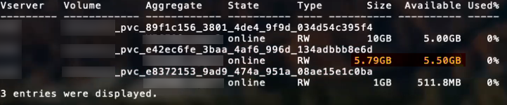

= ONTAP SAN-Konfigurationsoptionen und Beispiele
:hardbreaks:
:allow-uri-read: 
:icons: font
:imagesdir: ../media/

[role="lead"]
ONTAP SAN-Treiber können mit Ihrer Trident Installation erstellt und verwendet werden. Dieser Abschnitt enthält Beispiele für die Backend-Konfiguration und Details zur Zuordnung von Backends zu StorageClasses. link:https://docs.netapp.com/us-en/asa-r2/get-started/learn-about.html["ASA r2-Systeme"^] unterscheiden sich von anderen ONTAP Systemen (ASA, AFF und FAS) in der Implementierung ihrer Speicherschicht. Diese Unterschiede wirken sich auf die Verwendung bestimmter Parameter aus, wie angegeben. link:https://docs.netapp.com/us-en/asa-r2/learn-more/hardware-comparison.html["Erfahren Sie mehr über die Unterschiede zwischen ASA r2-Systemen und anderen ONTAP Systemen"^]. In der Trident Backend-Konfiguration muss nicht angegeben werden, dass das System ASA r2 ist. Wenn  `ontap-san` als  `storageDriverName` ausgewählt wird, erkennt Trident automatisch ASA r2 oder andere ONTAP Systeme. Einige Backend-Konfigurationsparameter sind für ASA r2 Systeme nicht anwendbar, wie in der folgenden Tabelle aufgeführt.

NOTE: Nur der  `ontap-san` driver (mit iSCSI-, NVMe/TCP- und FC-Protokollen) wird für ASA r2-Systeme unterstützt.

[[backend-configuration-options]]
== Backend-Konfigurationsoptionen

Ab der Version 26.06 kann die ONTAP Balanced Placement-Funktion aktiviert werden, sodass ONTAP das Aggregat für neue Volumes auswählt. Siehe link:ontap-balanced-placement.html["Ausgewogene Platzierung mit ONTAP Backends verwenden"] für Anforderungen und Beispiele.

Siehe die folgende Tabelle für die Backend-Konfigurationsoptionen:

[cols="1,3,2"]
|===
| Parameter | Beschreibung | Standard 

| `version` |  | Immer 1 

| `storageDriverName` | Name des Speichertreibers. Kann nach der Erstellung nicht mehr geändert werden. Zum Aktualisieren dieses Parameters ist die Erstellung eines neuen Backends erforderlich. | `ontap-san` oder `ontap-san-economy` 

| `backendName` | Benutzerdefinierter Name oder das Speicher-Backend | Treibername + "_" + dataLIF 

| `managementLIF`  a| 
IP-Adresse einer Cluster- oder SVM-Management-LIF.

Es kann ein vollqualifizierter Domain-Name (FQDN) angegeben werden.

Kann so eingestellt werden, dass IPv6-Adressen verwendet werden, wenn Trident mit dem IPv6-Flag installiert wurde. IPv6-Adressen müssen in eckigen Klammern angegeben werden, wie  `[28e8:d9fb:a825:b7bf:69a8:d02f:9e7b:3555]`.

Für einen reibungslosen MetroCluster-Switchover siehe <<mcc-best>>.

NOTE: Wenn Sie „vsadmin“-Anmeldeinformationen verwenden,  `managementLIF` muss dies die der SVM sein; wenn Sie „admin“-Anmeldeinformationen verwenden,  `managementLIF` muss dies die des Clusters sein.
| "10.0.0.1", "[2001:1234:abcd::fefe]" 

| `dataLIF` | IP-Adresse des Protokoll-LIF. Kann so eingestellt werden, dass IPv6-Adressen verwendet werden, wenn Trident mit dem IPv6-Flag installiert wurde. IPv6-Adressen müssen in eckigen Klammern angegeben werden, wie  `[28e8:d9fb:a825:b7bf:69a8:d02f:9e7b:3555]`. *Nicht für iSCSI angeben.* Trident verwendet link:https://docs.netapp.com/us-en/ontap/san-admin/selective-lun-map-concept.html["ONTAP Selective LUN Map"^] zur Ermittlung der iSCSI-LIFs, die für den Aufbau einer Multipath-Sitzung benötigt werden. Eine Warnung wird generiert, wenn  `dataLIF` explizit definiert ist. *Für MetroCluster weglassen.* Siehe <<mcc-best>>. | Abgeleitet von der SVM 

| `svm` | Zu verwendende virtuelle Speichermaschine *Für MetroCluster auslassen.* Siehe <<mcc-best>>. | Wird abgeleitet, wenn eine SVM `managementLIF` angegeben ist 

| `useCHAP` | Verwenden Sie CHAP zur Authentifizierung von iSCSI für ONTAP SAN-Treiber [Boolescher Wert]. Setzen Sie auf  `true`, damit Trident bidirektionales CHAP als Standardauthentifizierung für die im Backend angegebene SVM konfiguriert und verwendet. Details sind in link:ontap-san-prep.html["Bereiten Sie die Konfiguration des Backends mit ONTAP SAN-Treibern vor"] zu finden. *Nicht unterstützt für FCP oder NVMe/TCP.* | `false` 

| `chapInitiatorSecret` | CHAP-Initiatorgeheimnis. Erforderlich, wenn `useCHAP=true` | "" 

| `labels` | Satz beliebiger JSON-formatierter Bezeichnungen, die auf Volumes angewendet werden sollen | "" 

| `chapTargetInitiatorSecret` | CHAP-Zielinitiatorgeheimnis. Erforderlich, wenn `useCHAP=true` | "" 

| `chapUsername` | Benutzername für eingehende Anfragen. Erforderlich, wenn `useCHAP=true` | "" 

| `chapTargetUsername` | Zielbenutzername. Erforderlich, wenn `useCHAP=true` | "" 

| `clientCertificate` | Base64-kodierter Wert des Clientzertifikats. Wird für zertifikatbasierte Authentifizierung verwendet | "" 

| `clientPrivateKey` | Base64-kodierter Wert des privaten Client-Schlüssels. Wird für zertifikatbasierte Authentifizierung verwendet | "" 

| `trustedCACertificate` | Base64-kodierter Wert des vertrauenswürdigen CA-Zertifikats. Optional. Wird für zertifikatbasierte Authentifizierung verwendet. | "" 

| `username` | Benutzername, der für die Kommunikation mit dem ONTAP Cluster benötigt wird. Wird für die anmeldeinformationsbasierte Authentifizierung verwendet. Für die Active Directory Authentifizierung siehe link:../trident-use/ontap-san-examples.html#authenticate-trident-to-a-backend-svm-using-active-directory-credentials["Authentifizieren Sie Trident bei einer Backend-SVM mit Active Directory-Anmeldeinformationen"]. | "" 

| `password` | Passwort erforderlich, um mit dem ONTAP Cluster zu kommunizieren. Wird für die anmeldeinformationsbasierte Authentifizierung verwendet. Für die Active Directory Authentifizierung siehe link:../trident-use/ontap-san-examples.html#authenticate-trident-to-a-backend-svm-using-active-directory-credentials["Authentifizieren Sie Trident bei einer Backend-SVM mit Active Directory-Anmeldeinformationen"]. | "" 

| `svm` | Zu verwendende Storage Virtual Machine | Wird abgeleitet, wenn eine SVM `managementLIF` angegeben ist 

| `storagePrefix` | Präfix, das beim Bereitstellen neuer Volumes in der SVM verwendet wird. Kann später nicht mehr geändert werden. Zum Aktualisieren dieses Parameters ist die Erstellung eines neuen Backends erforderlich. | `trident` 

| `aggregate`  a| 
Aggregat für die Bereitstellung (optional; falls festgelegt, muss es der SVM zugewiesen werden). Für den  `ontap-nas-flexgroup` Treiber wird diese Option ignoriert. Wenn kein Aggregat zugewiesen ist, kann jedes der verfügbaren Aggregate zur Bereitstellung eines FlexGroup Volumes verwendet werden.

NOTE: Wird das Aggregat in SVM aktualisiert, erfolgt die Aktualisierung in Trident automatisch durch regelmäßiges Abfragen von SVM, ohne dass der Trident Controller neu gestartet werden muss. Wenn in Trident ein bestimmtes Aggregat für die Volume-Bereitstellung konfiguriert wurde und dieses Aggregat umbenannt oder aus der SVM entfernt wird, wechselt das Backend in Trident beim Abfragen des SVM-Aggregats in den Fehlerzustand. Das Aggregat muss entweder auf eines geändert werden, das in der SVM vorhanden ist, oder vollständig entfernt werden, damit das Backend wieder online ist.

*Für ASA r2 Systeme nicht angeben*.

*Nicht angeben, wenn  `useBalancedPlacement` auf  `true` gesetzt ist.*
 a| 
""

| `useBalancedPlacement`  a| 
Aggregatauswahl für neue Volumes an ONTAP [Boolescher Wert]. Erfordert ONTAP 9.19.1 oder höher und  `useREST` auf  `true` gesetzt. Kann nicht mit  `aggregate` kombiniert werden.

Siehe link:ontap-balanced-placement.html["Ausgewogene Platzierung mit ONTAP Backends verwenden"] für Anforderungen und Beispiele.
| `false` 

| `limitAggregateUsage` | Die Bereitstellung schlägt fehl, wenn die Nutzung diesen Prozentsatz überschreitet. Wenn Sie ein Amazon FSx for NetApp ONTAP-Backend verwenden, geben Sie  `limitAggregateUsage` nicht an. Die bereitgestellten  `fsxadmin` und  `vsadmin` enthalten nicht die erforderlichen Berechtigungen, um die aggregierte Nutzung abzurufen und sie mit Trident zu begrenzen. *Für ASA r2 Systeme nicht angeben*. | "" (wird nicht standardmäßig erzwungen) 

| `limitVolumeSize` | Die Bereitstellung schlägt fehl, wenn die angeforderte Volume-Größe diesen Wert überschreitet. Außerdem wird die maximale Größe der von ihr für LUNs verwalteten Volumes beschränkt. | "" (wird nicht standardmäßig erzwungen) 

| `lunsPerFlexvol` | Maximale LUNs pro FlexVol, muss im Bereich [50, 200] liegen | `100` 

| `debugTraceFlags` | Debug-Flags zur Verwendung bei der Fehlersuche. Beispiel, {"api":false, "method":true} nicht verwenden, es sei denn, Sie führen eine Fehlersuche durch und benötigen eine detaillierte Protokollausgabe. | `null` 

| `useREST`  a| 
Boolescher Parameter zur Verwendung von ONTAP REST APIs.

 `useREST` Wenn auf `true` gesetzt, verwendet Trident ONTAP REST APIs zur Kommunikation mit dem Backend; wenn auf `false` gesetzt, verwendet Trident ONTAPI (ZAPI)-Aufrufe zur Kommunikation mit dem Backend. Diese Funktion erfordert ONTAP 9.11.1 und höher. Zusätzlich muss die verwendete ONTAP-Anmelderolle Zugriff auf die `ontapi` Anwendung haben. Dies wird durch die vordefinierten `vsadmin` und `cluster-admin` Rollen erfüllt. Ab der Trident 24.06-Version und ONTAP 9.15.1 oder höher ist `useREST` standardmäßig auf `true` gesetzt; ändern Sie `useREST` auf `false`, um ONTAPI (ZAPI)-Aufrufe zu verwenden.

`useREST` ist vollqualifiziert für NVMe/TCP.

NOTE: NVMe wird nur mit ONTAP REST APIs unterstützt und nicht mit ONTAPI (ZAPI).

*Falls angegeben, immer auf  `true` für ASA r2-Systeme setzen*.
| `true` für ONTAP 9.15.1 oder höher, andernfalls  `false`. 

 a| 
`sanType`
| Verwenden Sie zum Auswählen  `iscsi` für iSCSI,  `nvme` für NVMe/TCP oder  `fcp` für SCSI über Fibre Channel (FC). | `iscsi` falls leer 

| `formatOptions`  a| 
Verwenden Sie  `formatOptions` zur Angabe von Befehlszeilenargumenten für den  `mkfs` Befehl, der immer dann angewendet wird, wenn ein Volume formatiert wird. Dadurch kann das Volume entsprechend den eigenen Präferenzen formatiert werden. Es ist darauf zu achten, dass formatOptions ähnlich wie die Optionen des Befehls mkfs angegeben werden, jedoch ohne den Gerätepfad. Beispiel: "-E nodiscard"

*Unterstützt für  `ontap-san` und  `ontap-san-economy` Treiber mit iSCSI-Protokoll.* *Zusätzlich unterstützt für ASA r2 Systeme bei Verwendung der Protokolle iSCSI und NVMe/TCP.*
 a| 

| `limitVolumePoolSize` | Maximal anforderbare FlexVol-Größe bei Verwendung von LUNs im ontap-san-economy Backend. | "" (wird nicht standardmäßig erzwungen) 

| `denyNewVolumePools` | Beschränkt `ontap-san-economy` Backends darauf, neue FlexVol Volumes zur Aufnahme ihrer LUNs zu erstellen. Für die Bereitstellung neuer PVs werden ausschließlich bereits vorhandene FlexVols verwendet. |  
|===

[[recommendations-for-using-formatoptions]]
=== Empfehlungen zur Verwendung von formatOptions

Trident empfiehlt die folgenden Optionen, um den Formatierungsprozess zu beschleunigen:

* *-E nodiscard (ext3, ext4):* Versuche nicht, Blöcke während der Erstellung des Dateisystems (mkfs) zu verwerfen (das anfängliche Verwerfen von Blöcken ist auf Solid-State-Geräten und dünnbesetzten/dünnprovisionierten Speichern sinnvoll). Dies ersetzt die veraltete Option "-K" und ist für ext3- und ext4-Dateisysteme anwendbar.
* *-K (xfs):* Versuche nicht, Blöcke beim mkfs zu verwerfen. Diese Option ist für das xfs-Dateisystem anwendbar.

[[authenticate-trident-to-a-backend-svm-using-active-directory-credentials]]
=== Authentifizieren Sie Trident bei einer Backend-SVM mit Active Directory-Anmeldeinformationen

Sie können Trident so konfigurieren, dass es sich mit Active Directory (AD)-Anmeldeinformationen an einer Backend-SVM authentifiziert. Bevor ein AD-Konto auf die SVM zugreifen kann, müssen Sie den Zugriff des AD-Domänencontrollers auf den Cluster oder die SVM konfigurieren. Für die Clusterverwaltung mit einem AD-Konto müssen Sie einen Domänentunnel erstellen. Details sind in link:https://docs.netapp.com/us-en/ontap/authentication/enable-ad-users-groups-access-cluster-svm-task.html["Konfigurieren des Zugriffs auf Active Directory-Domänencontroller in ONTAP"^] zu finden.

.Schritte
. Konfigurieren Sie die Domain Name System (DNS)-Einstellungen für eine Backend-SVM:
+
`vserver services dns create -vserver <svm_name> -dns-servers <dns_server_ip1>,<dns_server_ip2>`

. Führen Sie den folgenden Befehl aus, um ein Computerkonto für die SVM in Active Directory zu erstellen:
+
`vserver active-directory create -vserver DataSVM -account-name ADSERVER1 -domain demo.netapp.com`

. Verwenden Sie diesen Befehl, um einen AD-Benutzer oder eine Gruppe zu erstellen, die das Cluster oder die SVM verwalten.
+
`security login create -vserver <svm_name> -user-or-group-name <ad_user_or_group> -application <application> -authentication-method domain -role vsadmin`

. In der Trident-Backend-Konfigurationsdatei setzen Sie die  `username` und  `password` Parameter auf den AD-Benutzer- bzw. Gruppennamen und das Passwort.

[[backend-configuration-options-for-provisioning-volumes]]
== Backend-Konfigurationsoptionen für die Bereitstellung von Volumes

Sie können die Standardbereitstellung mithilfe dieser Optionen im  `defaults` Abschnitt der Konfiguration steuern. Ein Beispiel finden Sie in den unten stehenden Konfigurationsbeispielen.

[cols="1,3,2"]
|===
| Parameter | Beschreibung | Standard 

| `spaceAllocation` | Speicherplatzzuweisung für LUNs | "true" *Falls angegeben, auf  `true` für ASA r2-Systeme setzen*. 

| `spaceReserve` | Speicherplatzreservierungsmodus: „none“ (dünn) oder „volume“ (dick). *Auf `none` für ASA r2-Systeme einstellen.* | "none" 

| `snapshotPolicy` | Zu verwendende Snapshot-Richtlinie. *Für  `none` ASA r2-Systeme festlegen*. | "none" 

| `qosPolicy` | QoS-Richtliniengruppe, die für erstellte Volumes zugewiesen werden soll. Wählen Sie eine von qosPolicy oder adaptiveQosPolicy pro Storage-Pool/Backend. Die Verwendung von QoS-Richtliniengruppen mit Trident erfordert ONTAP 9.8 oder höher. Sie sollten eine nicht gemeinsam genutzte QoS-Richtliniengruppe verwenden und sicherstellen, dass die Richtliniengruppe auf jedes einzelne Element angewendet wird. Eine gemeinsam genutzte QoS-Richtliniengruppe erzwingt die Obergrenze für den Gesamtdurchsatz aller Workloads. | "" 

| `adaptiveQosPolicy` | Adaptive QoS-Richtliniengruppe zur Zuweisung für erstellte Volumes. Wählen Sie eine der qosPolicy oder adaptiveQosPolicy pro Speicherpool/Backend aus. | "" 

| `snapshotReserve` | Prozentsatz des für Snapshots reservierten Speichervolumens. *Für ASA r2 Systeme nicht angeben*. | "0", falls  `snapshotPolicy`"none", andernfalls "" 

| `splitOnClone` | Trennen Sie einen Klon bei seiner Erstellung von seinem übergeordneten Objekt | "false" 

| `encryption` | Aktivieren Sie NetApp Volume Encryption (NVE) auf dem neuen Volume; standardmäßig  `false`. NVE muss auf dem Cluster lizenziert und aktiviert sein, damit diese Option verwendet werden kann. Wenn NAE im Backend aktiviert ist, ist jedes in Trident bereitgestellte Volume NAE-aktiviert. Weitere Informationen unter: link:../trident-reco/security-reco.html["Wie Trident mit NVE und NAE zusammenarbeitet"]. | "false" *Falls angegeben, auf  `true` für ASA r2-Systeme setzen*. 

| `luksEncryption` | LUKS-Verschlüsselung aktivieren. Weitere Informationen enthält link:../trident-reco/security-luks.html["Verwenden Sie Linux Unified Key Setup (LUKS)"]. | "" *Auf  `false` für ASA r2-Systeme setzen*. 

| `tieringPolicy` | Tiering-Richtlinie auf "keine" setzen *Für ASA r2-Systeme nicht angeben*. |  

| `nameTemplate` | Vorlage zum Erstellen benutzerdefinierter Volume-Namen. | "" 
|===

[[volume-provisioning-examples]]
=== Beispiele für die Volume-Bereitstellung

Hier ist ein Beispiel mit definierten Standardwerten:

[source, yaml]
----
---
version: 1
storageDriverName: ontap-san
managementLIF: 10.0.0.1
svm: trident_svm
username: admin
password: <password>
labels:
  k8scluster: dev2
  backend: dev2-sanbackend
storagePrefix: alternate-trident
debugTraceFlags:
  api: false
  method: true
defaults:
  spaceReserve: volume
  qosPolicy: standard
  spaceAllocation: 'false'
  snapshotPolicy: default
  snapshotReserve: '10'

----

NOTE: Für alle Volumes, die mit dem  `ontap-san` Treiber erstellt werden, fügt Trident dem FlexVol zusätzlich 10 Prozent Kapazität hinzu, um die LUN-Metadaten aufzunehmen. Die LUN wird mit genau der Größe bereitgestellt, die der Benutzer im PVC anfordert. Trident fügt dem FlexVol 10 Prozent hinzu (wird als verfügbare Größe in ONTAP angezeigt). Benutzer erhalten nun die von ihnen angeforderte nutzbare Kapazität. Diese Änderung verhindert außerdem, dass LUNs schreibgeschützt werden, solange der verfügbare Speicherplatz nicht vollständig genutzt ist. Dies gilt nicht für ontap-san-economy.

Für Backends, die  `snapshotReserve` definieren, berechnet Trident die Größe der Volumes wie folgt:

[listing]
----
Total volume size = [(PVC requested size) / (1 - (snapshotReserve percentage) / 100)] * 1.1
----
Die 1,1 ist die zusätzlichen 10 Prozent, die Trident dem FlexVol hinzufügt, um die LUN-Metadaten aufzunehmen. Für  `snapshotReserve` = 5 % und eine PVC-Anforderung von 5 GiB beträgt die Gesamtgröße des Volumes 5,79 GiB und die verfügbare Größe 5,5 GiB. Der  `volume show`-Befehl sollte Ergebnisse ähnlich diesem Beispiel anzeigen:

Aktuell ist die Größenänderung die einzige Möglichkeit, die neue Berechnung für ein bestehendes Volume zu nutzen.

[[minimal-configuration-examples]]
== Minimale Konfigurationsbeispiele

Die folgenden Beispiele zeigen Basiskonfigurationen, bei denen die meisten Parameter auf Standardwerte eingestellt sind. Dies ist die einfachste Methode, ein Backend zu definieren.

NOTE: Wenn Sie Amazon FSx auf NetApp ONTAP mit Trident verwenden, empfiehlt NetApp, dass Sie für LIFs DNS-Namen anstelle von IP-Adressen angeben.

.ONTAP SAN-Beispiel
[%collapsible]
====
Dies ist eine Basiskonfiguration mit dem  `ontap-san` Treiber.

[source, yaml]
----
---
version: 1
storageDriverName: ontap-san
managementLIF: 10.0.0.1
svm: svm_iscsi
labels:
  k8scluster: test-cluster-1
  backend: testcluster1-sanbackend
username: vsadmin
password: <password>
----
====
.MetroCluster Beispiel
[#mcc-best%collapsible]
====
Sie können das Backend so konfigurieren, dass Sie die Backend-Definition nach einem Switchover und Switchback während link:../trident-reco/backup.html#svm-replication-and-recovery["SVM-Replikation und -Wiederherstellung"] nicht manuell aktualisieren müssen.

Für einen nahtlosen Übergang und Rückwechsel geben Sie die SVM mit  `managementLIF` an und lassen Sie die  `svm` Parameter weg. Beispiel:

[source, yaml]
----
version: 1
storageDriverName: ontap-san
managementLIF: 192.168.1.66
username: vsadmin
password: password
----
====
.ONTAP SAN economy Beispiel
[%collapsible]
====
[source, yaml]
----
version: 1
storageDriverName: ontap-san-economy
managementLIF: 10.0.0.1
svm: svm_iscsi_eco
username: vsadmin
password: <password>
----
====
.Beispiel für zertifikatsbasierte Authentifizierung
[%collapsible]
====
In diesem Basiskonfigurationsbeispiel  `clientCertificate`,  `clientPrivateKey`, und  `trustedCACertificate` (optional, wenn eine vertrauenswürdige CA verwendet wird) werden in  `backend.json` gefüllt und nehmen die base64-kodierten Werte des Clientzertifikats, des privaten Schlüssels bzw. des Zertifikats der vertrauenswürdigen CA an.

[source, yaml]
----
---
version: 1
storageDriverName: ontap-san
backendName: DefaultSANBackend
managementLIF: 10.0.0.1
svm: svm_iscsi
useCHAP: true
chapInitiatorSecret: cl9qxIm36DKyawxy
chapTargetInitiatorSecret: rqxigXgkesIpwxyz
chapTargetUsername: iJF4heBRT0TCwxyz
chapUsername: uh2aNCLSd6cNwxyz
clientCertificate: ZXR0ZXJwYXB...ICMgJ3BhcGVyc2
clientPrivateKey: vciwKIyAgZG...0cnksIGRlc2NyaX
trustedCACertificate: zcyBbaG...b3Igb3duIGNsYXNz
----
====
.Beispiele für bidirektionales CHAP
[%collapsible]
====
Diese Beispiele erstellen ein Backend mit  `useCHAP` auf  `true` gesetzt.

.ONTAP SAN CHAP Beispiel
[source, yaml]
----
---
version: 1
storageDriverName: ontap-san
managementLIF: 10.0.0.1
svm: svm_iscsi
labels:
  k8scluster: test-cluster-1
  backend: testcluster1-sanbackend
useCHAP: true
chapInitiatorSecret: cl9qxIm36DKyawxy
chapTargetInitiatorSecret: rqxigXgkesIpwxyz
chapTargetUsername: iJF4heBRT0TCwxyz
chapUsername: uh2aNCLSd6cNwxyz
username: vsadmin
password: <password>
----
.ONTAP SAN economy CHAP Beispiel
[source, yaml]
----
---
version: 1
storageDriverName: ontap-san-economy
managementLIF: 10.0.0.1
svm: svm_iscsi_eco
useCHAP: true
chapInitiatorSecret: cl9qxIm36DKyawxy
chapTargetInitiatorSecret: rqxigXgkesIpwxyz
chapTargetUsername: iJF4heBRT0TCwxyz
chapUsername: uh2aNCLSd6cNwxyz
username: vsadmin
password: <password>
----
====
.Beispiel für eine ausgewogene Platzierung
[%collapsible]
====
Dieses Beispiel aktiviert die ausgewogene Platzierung in ONTAP, sodass ONTAP das Aggregat für neue Volumes auswählt. Die ausgewogene Platzierung erfordert ONTAP 9.19.1 oder höher. Details sind in link:ontap-balanced-placement.html["Ausgewogene Platzierung mit ONTAP Backends verwenden"] zu finden.

[source, yaml]
----
---
version: 1
storageDriverName: ontap-san
backendName: san-balanced-placement
managementLIF: 10.0.0.1
svm: svm_iscsi
username: vsadmin
password: <password>
useBalancedPlacement: true
----
====
.NVMe/TCP-Beispiel
[%collapsible]
====
Sie müssen eine SVM mit NVMe auf Ihrem ONTAP Backend konfiguriert haben. Dies ist eine grundlegende Backend-Konfiguration für NVMe/TCP.

[source, yaml]
----
---
version: 1
backendName: NVMeBackend
storageDriverName: ontap-san
managementLIF: 10.0.0.1
svm: svm_nvme
username: vsadmin
password: password
sanType: nvme
useREST: true
----
====
.SCSI über FC (FCP) Beispiel
[%collapsible]
====
Sie benötigen eine SVM, die mit FC auf Ihrem ONTAP Backend konfiguriert ist. Dies ist eine grundlegende Backend-Konfiguration für FC.

[source, yaml]
----
---
version: 1
backendName: fcp-backend
storageDriverName: ontap-san
managementLIF: 10.0.0.1
svm: svm_fc
username: vsadmin
password: password
sanType: fcp
useREST: true
----
====
.Beispiel für die Backend-Konfiguration mit nameTemplate
[%collapsible]
====
[source, yaml]
----
---
version: 1
storageDriverName: ontap-san
backendName: ontap-san-backend
managementLIF: <ip address>
svm: svm0
username: <admin>
password: <password>
defaults:
  nameTemplate: "{{.volume.Name}}_{{.labels.cluster}}_{{.volume.Namespace}}_{{.vo\
    lume.RequestName}}"
labels:
  cluster: ClusterA
  PVC: "{{.volume.Namespace}}_{{.volume.RequestName}}"
----
====
.formatOptions example für den ontap-san-economy Treiber
[%collapsible]
====
[source, yaml]
----
---
version: 1
storageDriverName: ontap-san-economy
managementLIF: ""
svm: svm1
username: ""
password: "!"
storagePrefix: whelk_
debugTraceFlags:
  method: true
  api: true
defaults:
  formatOptions: -E nodiscard
----
====

[[examples-of-backends-with-virtual-pools]]
== Beispiele für Backends mit virtuellen Pools

In diesen Beispiel-Backend-Definitionsdateien sind spezifische Standardwerte für alle Speicherpools festgelegt, wie  `spaceReserve` bei none,  `spaceAllocation` bei false und  `encryption` bei false. Die virtuellen Pools werden im Speicherabschnitt definiert.

Trident legt Bereitstellungsbezeichnungen im Feld „Kommentare“ fest. Kommentare werden auf dem FlexVol volume festgelegt. Trident kopiert bei der Bereitstellung alle im virtuellen Pool vorhandenen Bezeichnungen auf das Speichervolume. Zur Vereinfachung können Speicheradministratoren Bezeichnungen pro virtuellem Pool definieren und Volumes nach Bezeichnung gruppieren.

In diesen Beispielen legen einige Speicherpools ihre eigenen `spaceReserve`, `spaceAllocation`, und `encryption` Werte fest, und einige Pools überschreiben die Standardwerte.

.ONTAP SAN-Beispiel
[%collapsible]
====
[source, yaml]
----
---
version: 1
storageDriverName: ontap-san
managementLIF: 10.0.0.1
svm: svm_iscsi
useCHAP: true
chapInitiatorSecret: cl9qxIm36DKyawxy
chapTargetInitiatorSecret: rqxigXgkesIpwxyz
chapTargetUsername: iJF4heBRT0TCwxyz
chapUsername: uh2aNCLSd6cNwxyz
username: vsadmin
password: <password>
defaults:
  spaceAllocation: "false"
  encryption: "false"
  qosPolicy: standard
labels:
  store: san_store
  kubernetes-cluster: prod-cluster-1
region: us_east_1
storage:
  - labels:
      protection: gold
      creditpoints: "40000"
    zone: us_east_1a
    defaults:
      spaceAllocation: "true"
      encryption: "true"
      adaptiveQosPolicy: adaptive-extreme
  - labels:
      protection: silver
      creditpoints: "20000"
    zone: us_east_1b
    defaults:
      spaceAllocation: "false"
      encryption: "true"
      qosPolicy: premium
  - labels:
      protection: bronze
      creditpoints: "5000"
    zone: us_east_1c
    defaults:
      spaceAllocation: "true"
      encryption: "false"

----
====
.ONTAP SAN economy Beispiel
[%collapsible]
====
[source, yaml]
----
---
version: 1
storageDriverName: ontap-san-economy
managementLIF: 10.0.0.1
svm: svm_iscsi_eco
useCHAP: true
chapInitiatorSecret: cl9qxIm36DKyawxy
chapTargetInitiatorSecret: rqxigXgkesIpwxyz
chapTargetUsername: iJF4heBRT0TCwxyz
chapUsername: uh2aNCLSd6cNwxyz
username: vsadmin
password: <password>
defaults:
  spaceAllocation: "false"
  encryption: "false"
labels:
  store: san_economy_store
region: us_east_1
storage:
  - labels:
      app: oracledb
      cost: "30"
    zone: us_east_1a
    defaults:
      spaceAllocation: "true"
      encryption: "true"
  - labels:
      app: postgresdb
      cost: "20"
    zone: us_east_1b
    defaults:
      spaceAllocation: "false"
      encryption: "true"
  - labels:
      app: mysqldb
      cost: "10"
    zone: us_east_1c
    defaults:
      spaceAllocation: "true"
      encryption: "false"
  - labels:
      department: legal
      creditpoints: "5000"
    zone: us_east_1c
    defaults:
      spaceAllocation: "true"
      encryption: "false"

----
====
.NVMe/TCP-Beispiel
[%collapsible]
====
[source, yaml]
----
---
version: 1
storageDriverName: ontap-san
sanType: nvme
managementLIF: 10.0.0.1
svm: nvme_svm
username: vsadmin
password: <password>
useREST: true
defaults:
  spaceAllocation: "false"
  encryption: "true"
storage:
  - labels:
      app: testApp
      cost: "20"
    defaults:
      spaceAllocation: "false"
      encryption: "false"

----
====

[[map-backends-to-storageclasses]]
== Backends zu StorageClasses zuordnen

Die folgenden StorageClass-Definitionen beziehen sich auf die <<Beispiele für Backends mit virtuellen Pools>>. Mit dem  `parameters.selector`-Feld wird bei jeder StorageClass angegeben, welche virtuellen Pools zum Hosten eines Volumes verwendet werden können. Das Volume verfügt nun über die im ausgewählten virtuellen Pool definierten Aspekte.

* Die  `protection-gold` StorageClass verweist auf den ersten virtuellen Pool im  `ontap-san` Backend. Dies ist der einzige Pool, der Schutz auf Gold-Niveau bietet.
+
[source, yaml]
----
apiVersion: storage.k8s.io/v1
kind: StorageClass
metadata:
  name: protection-gold
provisioner: csi.trident.netapp.io
parameters:
  selector: "protection=gold"
  fsType: "ext4"
----
* Die  `protection-not-gold` StorageClass verweist auf den zweiten und dritten virtuellen Pool im  `ontap-san` Backend. Dies sind die einzigen Pools, die ein anderes Schutzniveau als Gold bieten.
+
[source, yaml]
----
apiVersion: storage.k8s.io/v1
kind: StorageClass
metadata:
  name: protection-not-gold
provisioner: csi.trident.netapp.io
parameters:
  selector: "protection!=gold"
  fsType: "ext4"
----
* Die  `app-mysqldb` StorageClass wird dem dritten virtuellen Pool im  `ontap-san-economy` Backend zugeordnet. Dies ist der einzige Pool, der eine Speicherpoolkonfiguration für den Anwendungstyp mysqldb bietet.
+
[source, yaml]
----
apiVersion: storage.k8s.io/v1
kind: StorageClass
metadata:
  name: app-mysqldb
provisioner: csi.trident.netapp.io
parameters:
  selector: "app=mysqldb"
  fsType: "ext4"
----
* Die `protection-silver-creditpoints-20k` StorageClass verweist auf den zweiten virtuellen Pool im `ontap-san` Backend. Dies ist der einzige Pool, der Schutz auf Silber-Niveau und 20000 Kreditpunkte bietet.
+
[source, yaml]
----
apiVersion: storage.k8s.io/v1
kind: StorageClass
metadata:
  name: protection-silver-creditpoints-20k
provisioner: csi.trident.netapp.io
parameters:
  selector: "protection=silver; creditpoints=20000"
  fsType: "ext4"
----
* Die `creditpoints-5k` StorageClass verweist auf den dritten virtuellen Pool im `ontap-san` Backend und auf den vierten virtuellen Pool im `ontap-san-economy` Backend. Dies sind die einzigen Poolangebote mit 5000 Kreditpunkten.
+
[source, yaml]
----
apiVersion: storage.k8s.io/v1
kind: StorageClass
metadata:
  name: creditpoints-5k
provisioner: csi.trident.netapp.io
parameters:
  selector: "creditpoints=5000"
  fsType: "ext4"
----
* Die `my-test-app-sc` StorageClass wird dem `testAPP` virtuellen Pool im `ontap-san` Treiber mit `sanType: nvme` zugeordnet. Dies ist der einzige Pool, der `testApp` anbietet.
+
[source, yaml]
----
---
apiVersion: storage.k8s.io/v1
kind: StorageClass
metadata:
  name: my-test-app-sc
provisioner: csi.trident.netapp.io
parameters:
  selector: "app=testApp"
  fsType: "ext4"
----

Trident entscheidet, welcher virtuelle Pool ausgewählt wird und stellt sicher, dass die Speicheranforderung erfüllt wird.
