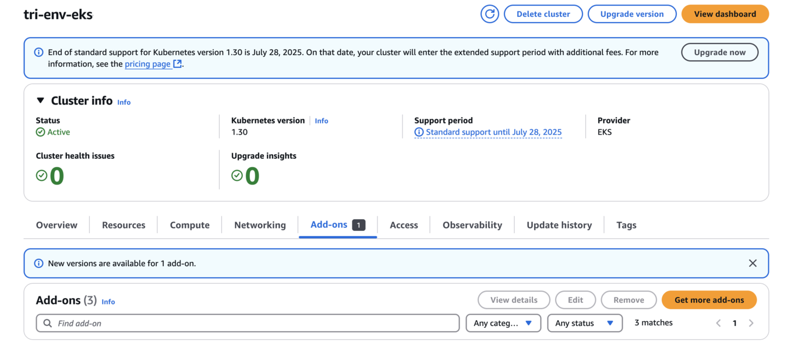
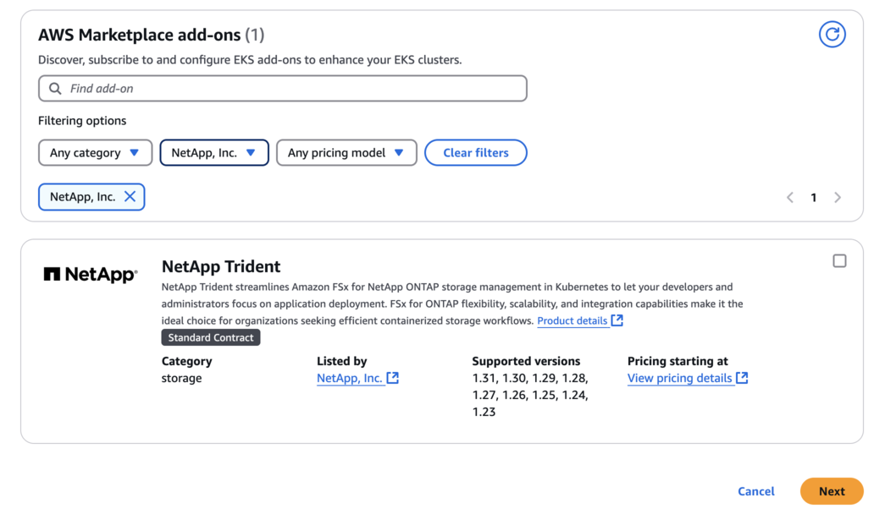
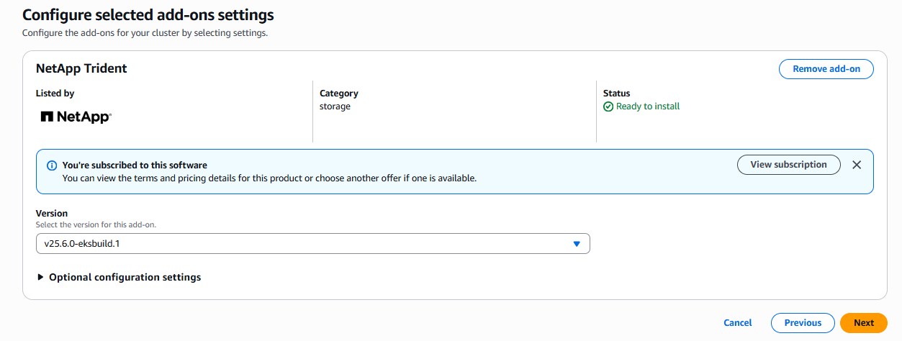
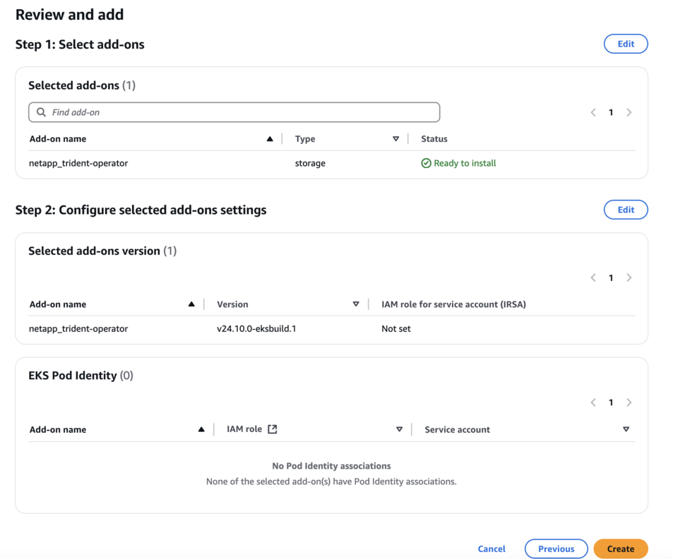
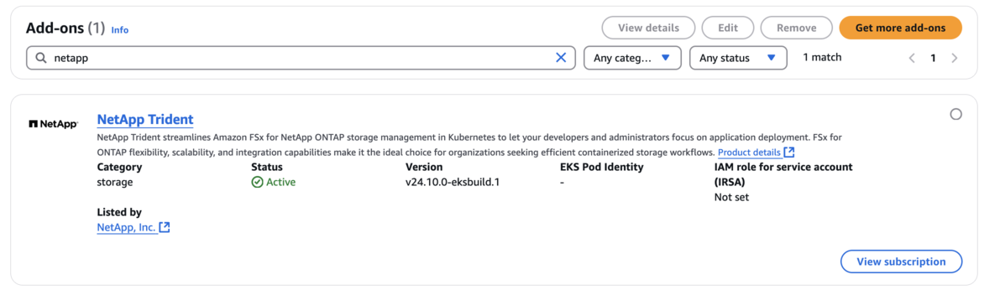

= Konfigurieren Sie das Trident EKS add-on auf einem EKS Cluster
:hardbreaks:
:allow-uri-read: 
:icons: font
:imagesdir: ../media/

[role="lead"]
NetApp Trident vereinfacht die Verwaltung von Amazon FSx for NetApp ONTAP Storage in Kubernetes, sodass sich Ihre Entwickler und Administratoren auf die Anwendungsbereitstellung konzentrieren können. Das NetApp Trident EKS Add-on enthält die neuesten Sicherheitspatches, Fehlerbehebungen und ist von AWS für die Zusammenarbeit mit Amazon EKS validiert. Das EKS-Add-on ermöglicht es Ihnen, konsequent sicherzustellen, dass Ihre Amazon EKS-Cluster sicher und stabil sind, und reduziert den Arbeitsaufwand, den Sie für die Installation, Konfiguration und Aktualisierung von Add-ons aufwenden müssen.

[[prerequisites]]
== Voraussetzungen

Stellen Sie sicher, dass Sie Folgendes haben, bevor Sie das Trident-Add-on für AWS EKS konfigurieren:

* Ein Amazon EKS-Clusterkonto mit Berechtigungen zur Verwendung von Add-ons. Weitere Informationen enthält link:https://docs.aws.amazon.com/eks/latest/userguide/eks-add-ons.html["Amazon EKS Add-ons"^].
* AWS-Berechtigungen für den AWS Marketplace:
`"aws-marketplace:ViewSubscriptions",
"aws-marketplace:Subscribe",
"aws-marketplace:Unsubscribe`
* AMI type: Amazon Linux 2 (AL2_x86_64) oder Amazon Linux 2 Arm (AL2_ARM_64)
* Knotentyp: AMD oder ARM
* Ein bestehendes Amazon FSx for NetApp ONTAP file system

[[steps]]
== Schritte

. Stellen Sie sicher, dass Sie eine IAM-Rolle und ein AWS-Secret erstellen, damit EKS-Pods auf AWS-Ressourcen zugreifen können. Anweisungen finden sich unter link:../trident-use/trident-fsx-iam-role.html["Erstellen Sie eine IAM-Rolle und ein AWS-Geheimnis"^].
. Navigieren Sie in Ihrem EKS Kubernetes-Cluster zur Registerkarte *Add-ons*.
+

. Gehen Sie zu *AWS Marketplace add-ons* und wählen Sie die Kategorie _storage_.
+

. Suchen Sie *NetApp Trident* und aktivieren Sie das Kontrollkästchen für das Trident-Add-on, und klicken Sie auf *Weiter*.
. Wählen Sie die gewünschte Version des Add-on.
+

. Konfigurieren Sie die erforderlichen Add-on-Einstellungen.
+

. Wenn Sie IRSA (IAM roles for service account) verwenden, beachten Sie die zusätzlichen Konfigurationsschritte link:https://docs.netapp.com/us-en/trident/trident-use/trident-fsx-install-trident.html#enable-the-trident-add-on-for-aws["hier,"].
. Die Option *Create* wird ausgewählt.
. Überprüfen Sie, ob der Status des Add-ons _Active_ ist.
+

. Führen Sie den folgenden Befehl aus, um zu überprüfen, ob Trident ordnungsgemäß auf dem Cluster installiert ist:
+
[listing]
----
kubectl get pods -n trident
----
. Fahren Sie mit der Einrichtung fort und konfigurieren Sie das Storage-Backend. Informationen finden sich unter link:trident-fsx-storage-backend.html["Konfigurieren Sie das Storage-Backend"].

[[installuninstall-the-trident-eks-add-on-using-cli]]
== Installieren/Deinstallieren des Trident EKS Add-ons über die CLI

.Installieren Sie das NetApp Trident EKS-Add-on mithilfe der CLI:
Der folgende Beispielbefehl installiert das Trident EKS-Add-on:
`eksctl create addon --cluster clusterName --name netapp_trident-operator --version v25.6.0-eksbuild.1` (mit einer dedizierten Version)

Der folgende Beispielbefehl installiert das Trident EKS-Add-on Version 25.6.1:
`eksctl create addon --cluster clusterName --name netapp_trident-operator --version v25.6.1-eksbuild.1` (mit einer dedizierten Version)

Der folgende Beispielbefehl installiert das Trident EKS-Add-on Version 25.6.2:
`eksctl create addon --cluster clusterName --name netapp_trident-operator --version v25.6.2-eksbuild.1` (mit einer dedizierten Version)

.Deinstallieren Sie das NetApp Trident EKS add-on über die CLI:
Der folgende Befehl deinstalliert das Trident EKS add-on:

[listing]
----
eksctl delete addon --cluster K8s-arm --name netapp_trident-operator
----